<p align="center">
  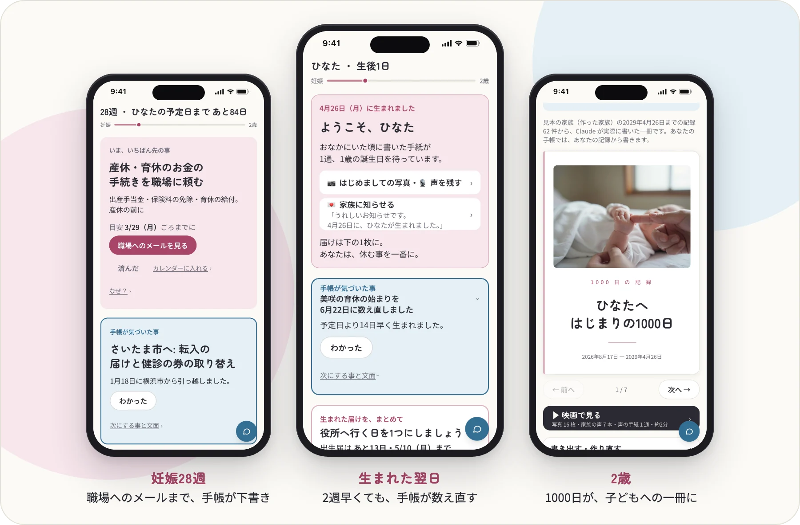
</p>

<h1 align="center">母子手帳を、<br>再発明する</h1>

<p align="center">
  <b>1948年、日本は母子手帳を発明した。<br>
  それは世界約50か国に広がった。<br>
  2026年、その次の形を作る。<br>
  読む手帳から、一緒に動く手帳へ。</b>
</p>

<p align="center">
  手続きは、手帳に任せて。<br>
  あなたは、子どものそばに。
</p>

<p align="center">
  <a href="https://youtu.be/XKPseCaHKGg"></a>
  <a href="https://boshi-techo-try.fly.dev/"></a>
  <a href="https://kamicham.github.io/boshi-techo/"></a><br>
  <sub>3分の動画: <a href="https://youtu.be/XKPseCaHKGg">https://youtu.be/XKPseCaHKGg</a><br>
  体験版: <a href="https://boshi-techo-try.fly.dev/">https://boshi-techo-try.fly.dev/</a> （ログイン不要）<br>
  作品のページ: <a href="https://kamicham.github.io/boshi-techo/">https://kamicham.github.io/boshi-techo/</a></sub>
</p>

<p align="center">
  <a href="https://github.com/Kamicham/boshi-techo/actions/workflows/check.yml"></a><br>
  <sub><b>Built with Claude: Japan 2026</b> の出品作<br>（テーマ #2「本来、誰にでも届くべきものを。」）<br>
  開発期間: 2026-11-02 12:30 〜 2026-11-08 20:00（JST）。<br>このリポジトリは期間中にゼロから作っています（<a href="https://github.com/Kamicham/boshi-techo/commit/f97bd3f46d0b2dbb556cbdae463f3c567a72262a">最初のコミット</a>は 11/2 20:51） ・ <a href="#english">English</a></sub>
</p>

### 4つの軸から見る

- **インパクト** — [なぜ作るか](#なぜ作るか)：出発点は、数年前、一人で産んで育てると決めた家族に、何もしてあげられなかった作り手の心残り。それとは別に、作り手自身も2026年12月に父になり、期間中はその出産に向けた本物の妊婦健診でも使った。役所・産院・会社がばらばらで、全体を持つ人がいない。2025年に生まれた子は 671,270人。親の少なくとも1人が外国人の子は 5.4％（2024年）。数字はすべて出典つき
- **デモ** — [3分の動画](https://youtu.be/XKPseCaHKGg)・[体験版](https://boshi-techo-try.fly.dev/)：見本の家族の写しが、あなただけに開く（登録なし・7日で消える）。妊娠8週から2歳までの8つの時期（もしもの引っ越しも）か、つまみで好きな日を選び、日本語・中文・English で見られる
- **Claude 活用** — [Claude の使い方](#claude-の使い方)：9つの仕事を Sonnet 5.5・Opus 5.5・Haiku 5.5 に分ける → [Claude Code での作り方](docs/BUILT_WITH_CLAUDE_CODE.md)
- **深さと実行力** — [確かめ方](#確かめ方)：修正のたびに、試験 1,534件と、1,030家族の1000日（のべ約106万日）を動かして23の決まりで確かめる早送りを CI で回す → [早送りの結果](docs/SIMULATION_RESULTS.md)

作り手: Kamicham（1人で参加。Cerebral Valley では Kamichama）。11/2〜11/4 のコミットの作者名 konnokun も同じ作り手で、11/4 に Git の名前の設定を揃えた。

## なぜ作るか

きっかけは、数年前の心残りです。家族の一人が、妊娠中から一人で産んで育てると決め、いろいろな事に一人で向き合わなければなりませんでした。作り手は、何もしてあげられませんでした。その無力感が、ずっと残っていました。今回いちばん多くの声をくれたのも、その家族です。

それとは別に、作り手自身も、2026年12月に父になります。期間中は、その出産に向けた本物の妊婦健診でもこの手帳を使い、そこで起きた日付の聞き違いから作り直しました（[作り手自身の話](#母子手帳の魂を引き継ぐ)）。

出産は一生に1〜2回。練習ができず、上達する前に終わります。役所は手続き、産院は体、会社は休業、親は手伝い。全体を持っている人がどこにもいなくて、つなぐのは一番経験の無い家族です。しかも、産後の眠れない数週間に、出生届（14日以内）・児童手当（15日以内）・保険・医療証が重なります。見本の家族の1000日だけでも、用事は49件、うち法の期限が13件あります。

自治体の電子母子手帳も母子手帳アプリも、記録と知らせを家族が読む手帳です（[今ある物との違い](#今ある物との違い)）。足りないのは情報ではなく、**全体を持って先回りして動いてくれる誰か**。それを、すべての家族に。詳しくは [docs/VISION.md](docs/VISION.md)。

| 数字 | 出典 |
|---|---|
| 母子手帳は1948年に日本で生まれ、世界約50か国で使われてきた | JICA（2024-02-15） |
| 2025年に生まれた子 671,270人 | 厚生労働省 人口動態統計（確定数・2026-09-30 公表） |
| 親の少なくとも1人が外国人の子 5.4％（38,389人・2024年） | 厚生労働省「令和6年 日本における外国人の人口動態」表1 |
| 出生届は14日以内 | 戸籍法第49条 |
| 見本の家族の1000日の用事 49件、うち法の期限 13件 | `app/src/lib/milestones.ts` の `scheduleFor` で数えた |

すべての家族には、日本語の読めない家族も入ります。だから手帳は、日本語・中文・English で使えます（上の帯の 🌐 で切り替え。役所や職場に出す下書きは日本語のまま）。

<p align="center">
  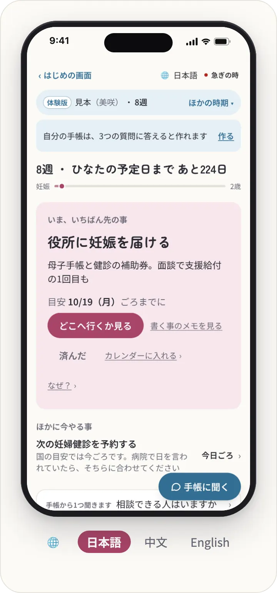
</p>

## 「読む手帳」から「一緒に動く手帳」へ

紙の母子手帳も、今の電子版も、**家族が読みに行く手帳**です。いつ何をするかを読んで覚え、窓口を探し、書類を書くのは家族です。この手帳は、家族の時計（妊娠週数・生後日数）で自分から起き、**家族と一緒に動きます**。

| | 読む手帳（紙・今の電子版） | 一緒に動く手帳（これ） |
|---|---|---|
| 次にやる事 | 家族が読んで覚える | その日に手帳から声をかける。今やる1つだけ |
| 書く | 家族が書き写す | 話す・撮るだけ。候補を出し、家族の「OK」で入る |
| 町の手続き | 家族が自分の町のページを探す | どの町でも、窓口・持ち物・期限を公式ページから取ってくる（出典つき） |
| 書類・連絡 | 家族が一から書く | 職場へのメール・出生届の記入メモ・見学の予約文まで下書きする。外へは送らない |
| 家族の分担 | 手帳を持つ母に寄る | パートナーも同じ手帳を開き、自分の番と自分の名前の下書きが出る |
| 予定が崩れた時 | 家族が組み直す | 早く生まれた・引っ越した時に、気づいて組み直し案と渡せる文面を出す |
| 健診 | 15分の説明を覚えて帰る | 録音して、聞こえた言葉を元のまま残し、次に聞く質問にする。聞こえた日付は「こう聞こえました」と見せて本人が決める。体の判断はしない |
| 1000日の後 | 手帳が残る | 記録と家族の言葉が、子どもへ語りかける一冊になる |

### 1000日のうちの、ある日

<p align="center">
  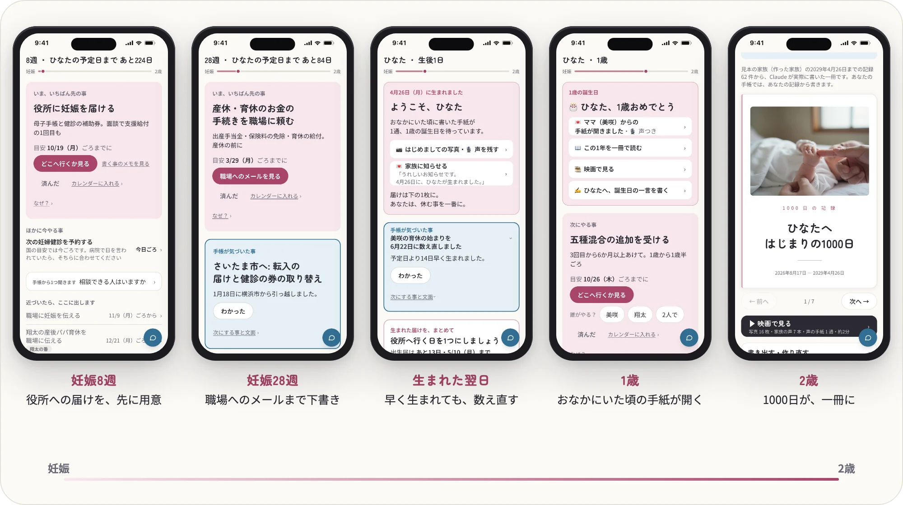
</p>

- **8週**: 「役所に妊娠を届ける」。住んでいる町の窓口・持ち物を公式ページから取ってきて、行く前に1枚で見せる
- **14週**: 「職場に妊娠を伝える」。会社名と上司の名前の入ったメールの下書き。家族は読んで「OK」
- **28週**: 「産休・育休のお金の手続きを職場に頼む」。出産手当金・保険料の免除・育休の給付を、職場へのメールの下書きにまとめる。この週の健診では、録音から先生が言った事・次までにやる事・次に聞く質問がそろう
- **引っ越した日**: 新しい町の窓口で、健診の補助券や医療証がどう変わるかを調べて組み直す
- **生まれた翌日**: 予定より2週早く生まれたら、1000日の用事のうち28件の日付を数え直す。出生届（14日）・児童手当（15日）・健康保険の加入・育休の始まりを担当つきで並べ直し、パートナーの育休の始まりを早める1件と、パートナーの名前の文面を出す
- **1歳**: 誕生日に、おなかにいた頃にママが書いた手紙（声つき）が開く。寝返り・つかまり立ち・予防接種の控えは、国の様式と同じ並びで積み上がっている
- **2歳**: 1000日の記録と家族の言葉が、子どもへの一冊になる

### 今ある物との違い

| | 誰の側か | 範囲 | 動き方 | 家族で1冊 |
|---|---|---|---|---|
| 国の電子版（PMH・2026年度末から順次） | 自治体 | 全国・転居も引き継ぐ | 記録の保管と閲覧 | 父などは代理人として |
| 母子モ・ninaru・LINEヤフー「子育て」 | 自治体／民間 | 町ごと・全国一律 | 知らせる・やる事の一覧 | 閲覧の共有・別のアプリ |
| この手帳 | 家族 | おなかに宿った日から2歳まで・どの町でも | 下書きまで作り、家族は OK だけ | 同じ1冊に、自分の番と自分の名前の下書き |

国の電子版とは競わず、補い合います（記録が PMH に載れば、この手帳はそこから読む側になる）。出典と確認日: [docs/LANDSCAPE.md](docs/LANDSCAPE.md)

## 一緒に動くための7つの性質

<p align="center">
  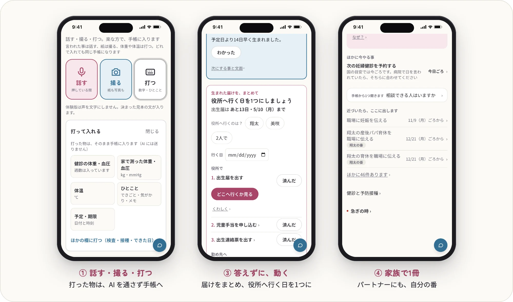
</p>

| | 性質 | このアプリで動くもの |
|---|---|---|
| ① | 入力ゼロ、でも押し付けない | 話すだけ・撮るだけ（役所の封筒、健診の紙）で、日付つきの記録と期限になる。打つ方が早い物（体重・血圧・体温・日付・時刻・ひとこと）は、話す・撮ると同じ大きさの「打つ」でその場で打て、AI を通さずそのまま手帳に入る。読み取った値も OK の前に直せる。足りない事は1つだけ聞く |
| ② | 1000日を生きる | 家族の時計（妊娠週数・生後日数）で、その日にやる事が自分から出てくる。住んでいる町の窓口・持ち物・助成は、Claude が市の公式ページを web 検索で取りに行き、出典つきで残す |
| ③ | 答えずに、動く | 職場への連絡、出生届の記入メモ、保育園見学の予約文。家族がするのは「OK」だけ（外へは何も送らない） |
| ④ | 家族で1冊 | パートナーも招待のリンクで同じ手帳を開き、自分の番の事と、自分の名前の下書きが出る。担当は法と制度で決まる人に振る（職場の事は働いている人。出生届は家族の用事で、届け出るのは父か母） |
| ⑤ | 医療は壁でなく橋 | **健診の1日を支える**: 前日に「明日 10:30 健診」と持ち物・聞く事を出し、診察の最初に「録音してもいいですか」と聞くよう添える → アプリで録音 → 自宅の GPU で文字起こし → 先生が言った事・次までにやる事・次の予約・難しい言葉の言い換え（元の言葉を並べる）・次に聞く質問。大きな病院の案内図を撮ると、今日回る順番になる。**体の判断はしない** |
| ⑥ | 町の制度を取りに行く | どの町でも、その手続きの窓口・持ち物・期限を、Claude が公式ページから取ってくる（「どこへ行くか見る」） |
| ⑦ | 子どもへの贈り物 | 府令と同じ並びの記録（手帳のタブ）と1000日の言葉が、最後に子どもへ語りかける一冊になる |

### 母子手帳の魂を引き継ぐ

紙の母子手帳（府令様式）が78年かけて磨いた7つ（持つ・続く・突き合わせる・証明する・つなぐ・想いを残す・取り残さない）を壊さずに引き継ぎます。

<p align="center">
  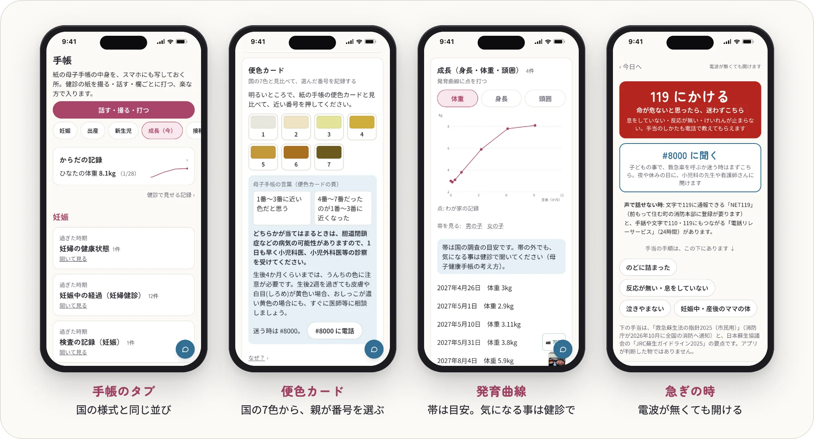
</p>

- **手帳のタブ**: 国の様式と同じ並び（妊婦健診 → 出産 → 新生児 → 便色カード → 成長・できた日 → 予防接種 → 相談した記録 → 一冊）で記録を見る。発育曲線はこども家庭庁「令和5年乳幼児身体発育調査」（2024-12-25 公表）の値（区分の間は直線でつないだ近似）、便色カードは国の7色から親が番号を選ぶ（アプリは判定しない。注意書きは手帳と同じ文言）
- **撮るだけ・話すだけで記録**: 紙の手帳のページを撮ると、Claude がどのページかを見分けて記録の候補を出す。「今日寝返りした」「BCG を受けた」と話しても候補になる。家族の「OK」で入る。紙の手帳が正本のまま、二重に書かせない
- **相談できる人**: 時期ごとに1回だけ「子育てについて気軽に相談できる人はいますか。」と聞く（紙の手帳の保護者の記録の毎回の問い。言葉もそのまま）。「いない」なら、町のこども家庭センター・産後ケア・#8000・児童相談所の相談ダイヤルへ橋をかける
- **急ぎの時**: 命が危ないと思ったら迷わず 119、救急車を呼ぶか迷う時は #8000（子ども）と #7119（ママの体・実施している町）、窒息の手当と心肺蘇生の要点（こども家庭庁の任意様式・日本蘇生協議会のガイドラインを元に短く）。電波が無くても開ける

作り手自身が、使う人の1号目です。家族の妊婦健診で、このアプリで先生の説明を録音して使っています（本物の記録は公開しません）。期間中の健診では、録音から作ったまとめが大事な日付を聞き違えました。そこで、聞こえた日付は本人が「大丈夫」を押すまでカレンダー・家族へ送る文・共有の1枚へ出さず、手帳の中では「録音から聞こえた日・まだ確かめていません」と添える形に作り直しています（[Claude Code での作り方](docs/BUILT_WITH_CLAUDE_CODE.md) の7）。

## Claude の使い方

仕事ごとにモデルを分けています。毎日の仕事は Sonnet、深く読む仕事は Opus、見張りと整えは Haiku です。

<p align="center">
  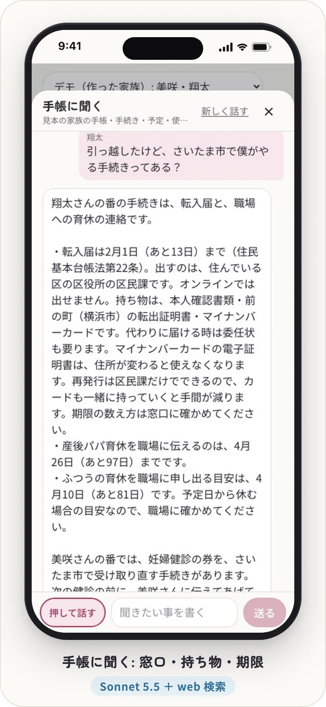
  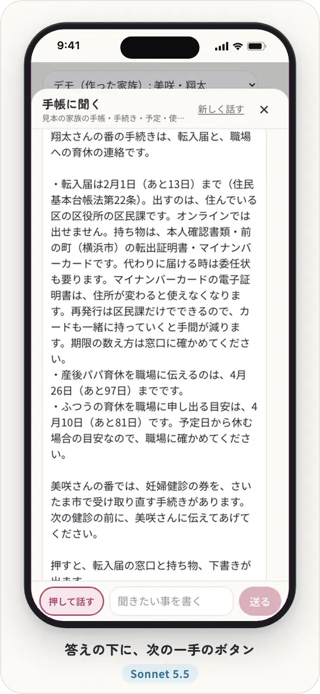
  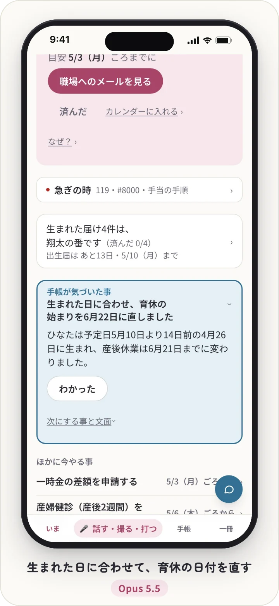
  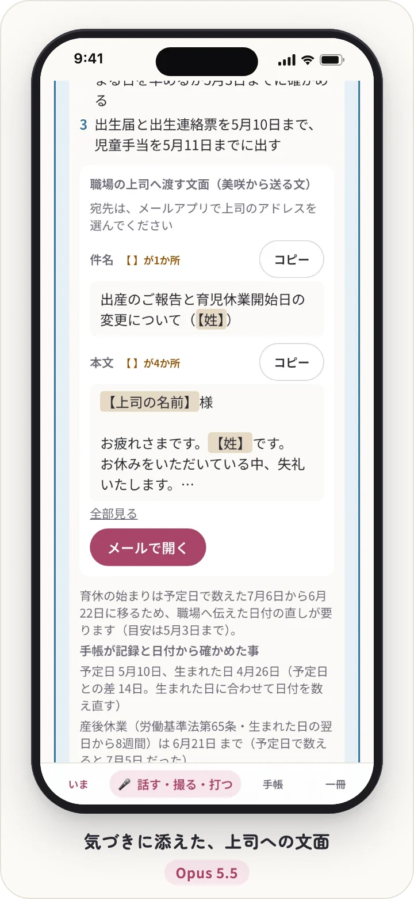
  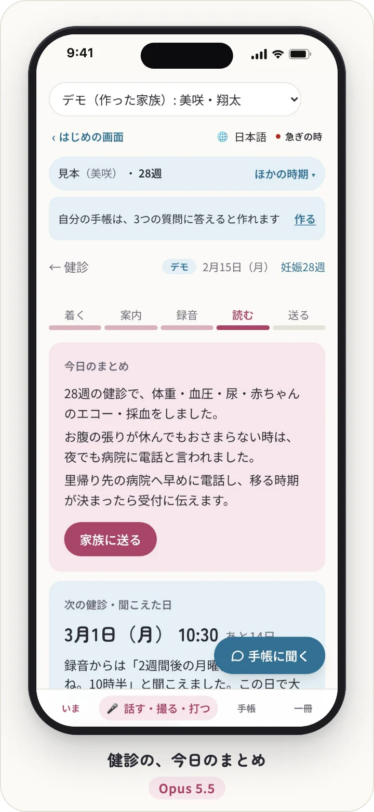
  
</p>

<p align="center"><sub>3分の動画の録画から（作った家族）。どれも本物の Claude の答えで、どのモデルが書いたかは録画の時の使った量の記録で確かめています</sub></p>

| 仕事 | モデル | 理由 |
|---|---|---|
| 撮る・話す（声と写真の読み取り → 記録の候補。紙の手帳のページを見分ける） | Sonnet 5.5（`EVERYDAY_MODEL`） | 毎日の仕事。単価は Opus の半分 |
| 下書き（職場へのメール・出生届の記入メモなど） | Sonnet 5.5（`EVERYDAY_MODEL`） | 毎日の仕事 |
| 手帳に聞く（道具を自分で選ぶ。最大8手）と、見張りに言われた時の書き直し | Sonnet 5.5（`EVERYDAY_MODEL`） | 毎日の仕事 |
| 調べ物（町の窓口・持ち物・期限。手帳に聞くの公式ページの検索と、引っ越しの時の前の町との差も） | Sonnet 5.5（`RESEARCH_MODEL`） | 1回に検索の結果を約8万トークン読む。書き出した文は後で整え、出典の URL も残すので、Sonnet で質を保てる |
| 参謀の気づき（早く・遅く生まれた・町が変わった時の組み直し）と、時期ごとの見渡し | Opus 5.5（`MODEL`） | 深い仕事。家族の形・予定・記録を突き合わせて、決まりに無い事を見つける |
| 健診の整理（先生が言った事・次までにやる事・次に聞く質問）と、院内の案内図から回る順番 | Opus 5.5（`MODEL`） | 深い仕事。聞こえた言葉を崩さずに分ける |
| 一冊（1000日の記録と家族の言葉から、子どもへの本） | Opus 5.5（`MODEL`） | 深い仕事。一度きりの長い文 |
| 手帳に聞くの見張り（体・心・栄養の判断の言葉を探す） | Haiku 5.5（`LIGHT_MODEL`） | 返事のたびに1回。軽い仕事 |
| 調べ物の整え（調べた文を、窓口・持ち物・期限の形に） | Haiku 5.5（`LIGHT_MODEL`） | 形を整えるだけの軽い仕事 |

正本は [`app/src/lib/claude.ts`](app/src/lib/claude.ts) の4つの定数（`MODEL`・`EVERYDAY_MODEL`・`LIGHT_MODEL`・`RESEARCH_MODEL`）です。Opus の仕事だけ、断られた時の呼び直し（server-side fallbacks）を付けています。

- 決まった形は Structured Outputs と zod で受け取る。写真は画像入力。調べ物は web 検索のツールで、答えの中で引用されたページを出典に残す（市区町村の公式サイトを優先するよう頼む）
- **手帳に聞く**（どの画面からも右下の「聞く」）: 道具（予定・手帳の記録・町の公式ページ・画面の地図・下書き・済みにする・健診で聞く・記録する・渡す文）を自分で選んで使い、答えるだけでなく返事の下に動きを添える。書き込む動きは家族が押すまで何も変えない。体・心・栄養は判断せず、記録・健診で聞く事・連絡先への橋に変える（急ぎ・心の危機の言葉には機械で必ず電話の案内を付け、返事は Haiku の見張りが判断の言葉を探し、あれば書き直させる）
- 体の判断をしない約束を、すべての呼び出しの共通の決まり（`CHARTER`）として持つ
- 使い過ぎ止め: 呼ぶたびに使った額を記録し（`lib/spend.ts`）、`BOSHI_DAILY_USD`（サーバ全体の1日）と `BOSHI_HOUSEHOLD_DAILY_USD`（1つの世帯の1日）を超えた日は、Claude の仕事だけを止める。予定表・期限・急ぎの時はそのまま使える
- 鍵が無い時と、上限に達した日は、見本の家族は [`lib/samples.ts`](app/src/lib/samples.ts) の「見本の答え」（札つき）で動く。町の窓口の調べ物と、健診の整理・院内の案内図は見本を作らない（鍵が要る）
- 公開版（体験）は、ハッカソンの間は Claude を呼ばない（鍵が入っていても呼ばない歯止めが `lib/claude.ts` にある）。体験の写しは、1つの住所から1日に作れる数（`BOSHI_TRIALS_PER_IP_DAY`。既定 10・公開版の設定は 100）と、1つの写しに置ける写真と声（20件・50MB）に上限がある
- 作る過程は **Claude Code** で進めた（計画 → 承認 → 実装を、機能ごとに並列のエージェントで）。コミットの履歴がその記録

## 動かし方

```bash
cd app
npm install
cp .env.example .env.local   # 頭の BOSHI_DATA_DIR=./try-data が試す時の置き場。ANTHROPIC_API_KEY と ASR_URL は空でも動く
npm run dev                  # http://localhost:3000
```

- `BOSHI_DATA_DIR` を消すと、`app/data/` を本物の家族の置き場として守り、アカウント・思い出・手紙・映画が止まる（作り手の家族の本番だけの形）
- **動かし方は4つ**: わが家の本番（home）・公開版の体験（public）・シミュレーション（sim）・手元の試し（dev）。置き場と環境変数の表は [docs/ARCHITECTURE.md](docs/ARCHITECTURE.md#動かし方)。公開版やシミュレーションが本物の家族の置き場を開くなど、危ない組み合わせはサーバが立つ時に止まる（`app/src/lib/mode.ts`）
- **鍵が無くても動く**: `ANTHROPIC_API_KEY` が空の時、予定表・期限・急ぎの時の連絡先はそのまま動き、デモの家族は Claude の仕事（撮る・下書き・気づき・聞く・一冊）を「見本の答え」で一通り触れる（撮った写真は読まない）。町の窓口の調べ物と、健診の整理・院内の案内図は鍵が要る（GPU は要らない）
- Claude の使い過ぎ止め: `BOSHI_DAILY_USD`（サーバ全体の1日）と `BOSHI_HOUSEHOLD_DAILY_USD`（1つの世帯の1日）。鍵は月の上限を付けたワークスペースで作る
- 文字起こし（健診の録音）は [asr/](asr/) の小さなサーバ（faster-whisper large-v3）を GPU の機械で動かし、`ASR_URL` で指す。音声は家のネットワークの外に出ない
- `ASR_URL` が無い時、見本の家族（作った家族）は用意したデモの文字起こしに切り替わる（画面に「デモの文字起こし」と出る）。GPU が無くても、健診の1日を試せる（先生の言葉の整理と案内図は鍵が要る）。本物の世帯の「話す」の記録は、デモの文を入れずに止める（`lib/asr.ts`）。わが家の本番は `ASR_URL` が無いと立たない
- スマホのマイクは https でないと使えない。家の機械で動かす時は Tailscale Serve などで https の住所を付ける
- 家族が毎日使う時は、組み立て済みの本番で動かす（`app/scripts/serve-prod.sh`）。更新は `app/scripts/release-prod.sh`: GitHub の main のきれいな写しから組み立て、3211番で確かめてから差し替え、だめなら前の版に戻す。開発サーバのままだと、コードを直した時に録音中の画面が読み直される
- デモの家族（すべて架空。町だけは実在の横浜市とさいたま市）は上の切り替えで選べる。時計を早送りできる

```bash
npm test          # 試験のすべて（Claude は呼ばない・鍵も使わない）
npm run sim       # 早送りの検査（1000組＋30家族 × 1000日）
npm run typecheck
```

## 公開版（体験）

だれでも、作った家族の手帳を自分だけの写しで触れる版です（`BOSHI_PUBLIC=1`）。いまの体験版: https://boshi-techo-try.fly.dev/ （ログイン不要）

- 開いた人ごとに、見本の家族の写しを1つ作る（札＝クッキーの持ち主だけが開ける。7日で消える）。ほかの人の書き込みは見えない
- 本物の家族の登録・招待・書き出しは閉じてある。健診の録音は、公開版ではまだ読むだけ
- **ハッカソンの間は、Claude を呼ばない**（Claude の鍵を入れない。鍵がうっかり入っても、公開版では呼ばない歯止めがある）。Claude の出番は、前に Claude が書いた一冊と、「見本の答え」の札が付いた答えで見せる。話した声は文字にせず、決まった見本の文が入る

自分で立てる（Fly.io の東京・月 $5 ほど）:

```bash
cd app
fly launch --no-deploy --copy-config --name <好きな名前>   # fly.toml の app を書き換える
fly volumes create boshi_data --region nrt --size 3
# 秘密は2つだけ。命令の引数に載せず、標準入力で渡す（値は画面にも出さない）
{ printf 'BETTER_AUTH_SECRET=%s\n' "$(openssl rand -hex 32)"; printf 'BOSHI_KEK=%s\n' "$(openssl rand -hex 32)"; } | fly secrets import --stage
fly deploy --remote-only   # 組み立ては Fly の機械で。像は、きれいな main の写しの app/ から組む
```

見本の素材は、すべて期間中に作った物で、実在の人ではありません。写真は Z-Image-Turbo（Apache-2.0）で生成。声は AivisSpeech の音声モデル「まお」「阿井田 茂」「ろてじん（長老ボイス）」（ACML 1.0）と、Qwen3-TTS 1.7B VoiceDesign（Apache-2.0・ばあばの声）で合成。映画の音楽は、端末で鳴らす自作のオルゴールです。字体は Zen Maru Gothic・Noto Sans JP（画面）と fonts-noto-cjk（公開版の像）で、どれも SIL Open Font License 1.1。

## しくみ

[docs/ARCHITECTURE.md](docs/ARCHITECTURE.md)（層の図・4つの動かし方・記録の種類・全国へ広げる時の置き場）

### 確かめ方

- **試験 116ファイル・1,534件**（2026-11-07 時点・`npm test`）。Claude は呼ばず、鍵も使わない。main への push と PR のたびに、GitHub Actions（`.github/workflows/check.yml`）が型・lint・試験・早送り・組み立て（next build）を回す
- **早送り: 23の決まり（a〜w）× 1,030家族 × 1000日**（`npm run sim`）。公的な統計から作った1000組（のべ 1,035,345日。家族は毎日動かし、画面は7日ごとと節目の日に確かめる）と、珍しい型の30家族（のべ 28,767日。毎日確かめる）を、「今日」の画面と同じ関数に通す。手帳の記録の決まり t1〜t9 は、見本の家族を足した1,031家族で確かめる。今はすべて守れている
- **世帯をまたぐ試験**: 家族Aのログインで家族Bの記録・済んだ事・手帳・写真の id を叩くと、どれも 404（`app/src/sim/cross-household.test.ts`）。API の口が（健診の口も）すべて、関所（`withHousehold`）か理由つきの公開の口を通るかを、コードを読んで確かめる（`app/src/sim/api-guard.test.ts`）

修正のたびに、公的な統計の割合から作った1000家族（すべて作った家族）でアプリの1000日を早送りしています。使った割合と出典: [docs/SIM_STATS.md](docs/SIM_STATS.md)

- 結果（早送りの決まり・なりきりで見つかった事と直したコミット・アンケートの前回比）: [docs/SIMULATION_RESULTS.md](docs/SIMULATION_RESULTS.md)
- Claude Code でどう作ったか（統計 → 1000組 → 早送り → Opus のなりきり → Sonnet のアンケート → 直す）: [docs/BUILT_WITH_CLAUDE_CODE.md](docs/BUILT_WITH_CLAUDE_CODE.md)

## License

MIT

---

<a id="english"></a>

<p align="center">
  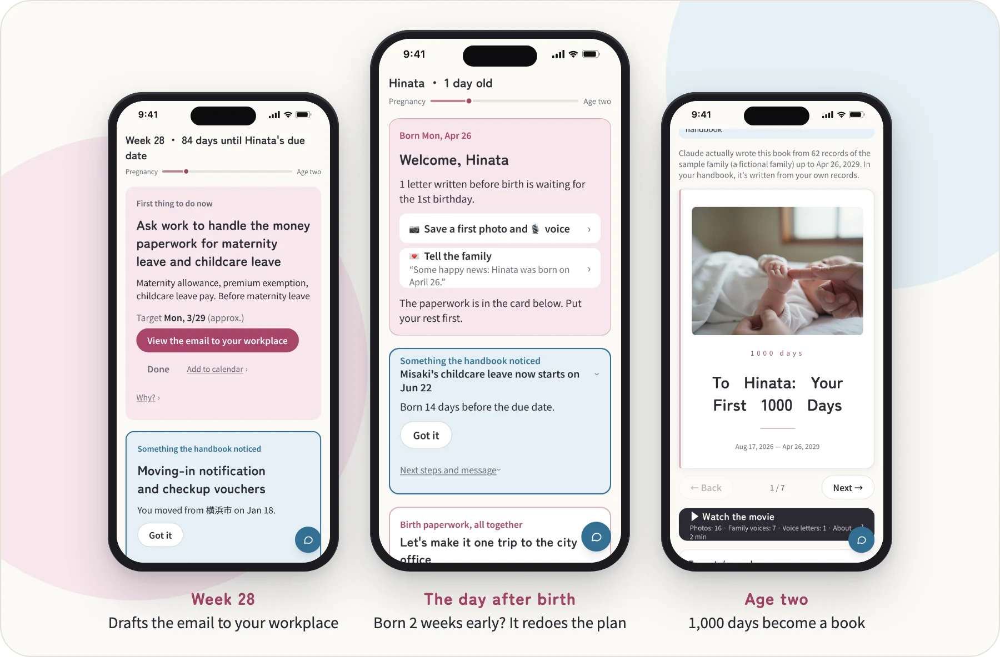
</p>

<h1 align="center">Reinventing the<br>Maternal and Child Health Handbook</h1>

<p align="center">
  <b>In 1948, Japan invented the Maternal and Child Health Handbook (Boshi Techo).<br>
  It has since spread to around 50 countries.<br>
  In 2026, we build what comes next:<br>
  from a handbook you read to a handbook that moves with you.</b>
</p>

<p align="center">
  Leave the paperwork to the handbook.<br>
  Stay close to your child.
</p>

<p align="center">
  <a href="https://youtu.be/XKPseCaHKGg"></a>
  <a href="https://boshi-techo-try.fly.dev/"></a>
  <a href="https://kamicham.github.io/boshi-techo/#en"></a><br>
  <sub>3-minute video: <a href="https://youtu.be/XKPseCaHKGg">https://youtu.be/XKPseCaHKGg</a> (in Japanese with English subtitles)<br>
  Live demo: <a href="https://boshi-techo-try.fly.dev/">https://boshi-techo-try.fly.dev/</a> (no login needed)<br>
  Project page: <a href="https://kamicham.github.io/boshi-techo/#en">https://kamicham.github.io/boshi-techo/</a></sub>
</p>

<p align="center">
  <sub>An entry to <b>Built with Claude: Japan 2026</b> (Theme #2: "What should reach everyone").<br>
  Built from scratch between 2026-11-02 12:30 and 2026-11-08 20:00 (JST). The <a href="https://github.com/Kamicham/boshi-techo/commit/f97bd3f46d0b2dbb556cbdae463f3c567a72262a">first commit</a> was at 20:51 on Nov 2.</sub>
</p>

### Four ways in

- **Impact** — [Why](#why): it started from the maker's regret, from a few years ago, at being unable to help a family member who decided to give birth and raise a child alone. Separately, the maker becomes a father in December 2026, and the handbook was used at the real prenatal checkups for that birth during the hackathon. The city office, the clinic and the employer each hold a piece, and no one holds the whole. 671,270 children were born in Japan in 2025; 5.4% of births have at least one foreign parent (2024). Every number has a source
- **Demo** — [3-minute video](https://youtu.be/XKPseCaHKGg) · [Public trial](https://boshi-techo-try.fly.dev/): a private copy of a sample family opens just for you (no sign-up, gone in 7 days). Pick one of eight moments from week 8 of pregnancy to age two (one is a move to a new city), or any day on the slider, in Japanese, Chinese or English
- **Use of Claude** — [How Claude is used](#how-claude-is-used): nine jobs split across Sonnet 5.5, Opus 5.5 and Haiku 5.5 → [How it was built with Claude Code](docs/BUILT_WITH_CLAUDE_CODE.md)
- **Depth & execution** — [Tests](#tests): on every change, CI runs 1,534 tests and a fast-forward that moves 1,030 families through 1,000 days (about 1.06 million family-days) and checks 23 rules → [Results](docs/SIMULATION_RESULTS.md)

Maker: Kamicham (solo entry; Kamichama on Cerebral Valley). The commits from Nov 2 to Nov 4 authored as konnokun are by the same maker; the Git name setting was unified on Nov 4.

## Why

It started with a regret from a few years ago. A family member decided during pregnancy to give birth and raise the child alone, and had to face everything alone. The maker could not do anything to help, and that helplessness never went away. That family member also gave the most feedback on this project.

Separately, the maker becomes a father in December 2026. During the hackathon the handbook was used at a real prenatal checkup for that birth to record the doctor's explanation, and a date misheard there reshaped the design (see [Carrying the soul of the paper handbook](#carrying-the-soul-of-the-paper-handbook)).

Most people give birth once or twice in a lifetime, so nobody gets to practice. The city office handles paperwork, the clinic handles the body, the employer handles leave, and grandparents help where they can. Nobody holds the whole picture except the family, who have the least experience. And the heaviest paperwork (birth registration within 14 days, child allowance within 15) lands in the sleepless weeks after birth. In the sample family's 1,000 days alone there are 49 tasks, 13 of them with legal deadlines.

City-run digital handbooks and handbook apps alike are handbooks where the family reads records and reminders ([how this differs](#from-a-handbook-you-read-to-a-handbook-that-moves-with-you)). What is missing is not information. It is **someone who holds the whole picture and moves ahead of you**. We want every family to have one.

| Number | Source |
|---|---|
| The handbook was born in Japan in 1948 and has been used in around 50 countries | JICA (2024-02-15) |
| 671,270 children born in Japan in 2025 | Ministry of Health, Labour and Welfare, Vital Statistics (final figures, published 2026-09-30) |
| 5.4% of births (38,389 in 2024) have at least one foreign parent | MHLW, 「令和6年 日本における外国人の人口動態」 (vital statistics of foreigners in Japan, 2024), Table 1 |
| Birth registration is due within 14 days | Family Register Act, Article 49 |
| 49 tasks in the sample family's 1,000 days, 13 with legal deadlines | Counted with `scheduleFor` in `app/src/lib/milestones.ts` |

Every family includes families who cannot read Japanese, so the handbook works in Japanese, Chinese (Simplified) and English (switch with 🌐 in the top bar; drafts for city offices and employers stay in Japanese).

<p align="center">
  
</p>

## From a handbook you read to a handbook that moves with you

The paper handbook, and today's digital versions, are handbooks the family reads. The family memorizes what comes next, looks up the city office, and fills in the forms. This handbook wakes up on the family's own clock (weeks of pregnancy, days since birth) and moves with them:

- **What's next**: it speaks up on the day, one thing at a time, instead of waiting to be read.
- **Writing**: talk or take a photo; it proposes entries and the family taps OK.
- **City procedures**: for any city, it fetches the office, what to bring and the deadline from official pages, with sources.
- **Paperwork**: it drafts the email to your boss, the birth-registration notes, the daycare visit request. Nothing is sent.
- **Sharing the load**: the partner opens the same handbook and sees their own turn, with drafts in their own name.
- **When plans break**: born early, moved to a new city: it notices, replans, and writes the message to hand over.
- **Checkups**: record the doctor's explanation, keep the words exactly as heard, and turn them into questions for next time. Dates it heard are shown as "this is what I heard — is it right?" and the family decides. It never judges health.
- **After 1,000 days**: the records and the family's words become a book that speaks to the child.

### A few days out of the 1,000

<p align="center">
  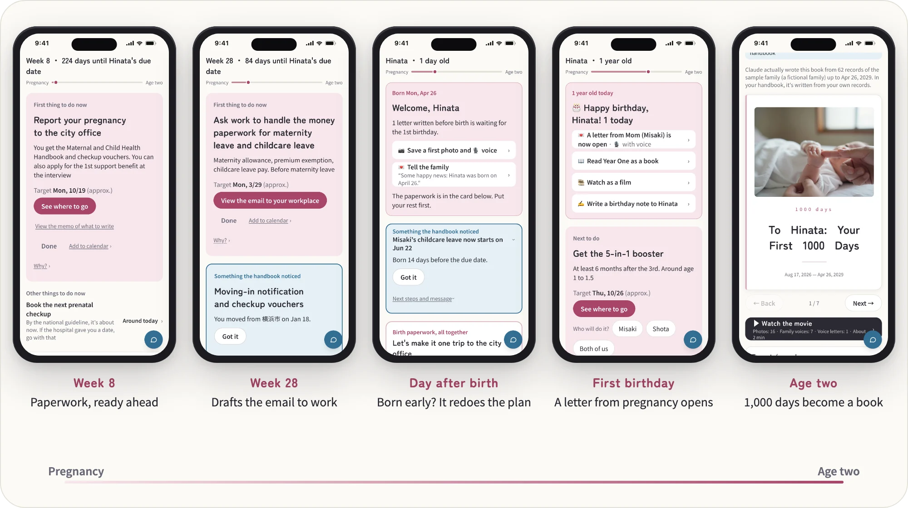
</p>

- **Week 8**: "Report your pregnancy to the city office." It fetches your own city's office and what to bring from official pages, and shows them on one card before you go.
- **Week 14**: "Tell work about your pregnancy." A drafted email with the company's and the manager's names. The family reads it and taps OK.
- **Week 28**: "Ask work to handle the money paperwork for maternity leave and childcare leave." The maternity allowance, the premium exemption and the childcare leave benefit go into one drafted email to the workplace. At this week's checkup, what the doctor said, what to do next and questions for next time come out of the recording.
- **Moving day**: it checks how checkup vouchers and medical cards change at the new city's office, and replans.
- **The day after birth**: born 2 weeks early? It recounts the dates of 28 of the 1,000 days' tasks, lays out birth registration (14 days), child allowance (15 days), enrolling the baby in health insurance and the start of leave with who does each, adds one new task (moving the partner's leave earlier) and a message in the partner's name.
- **Age one**: on the birthday, a letter mom wrote during pregnancy (with her voice) opens. Rolling over, pulling up to stand and vaccination records stack up in the same order as the national format.
- **Age two**: 1,000 days of records and the family's words become a book for the child.

Compared with what exists: the national digital handbook (PMH) stores and shows records for municipalities, and apps such as Boshimo, ninaru and LINE Yahoo "Kosodate" notify and list tasks. This handbook takes the family's side, spans any city for the first 1,000 days, and drafts the paperwork for an OK. It complements PMH rather than competing with it ([docs/LANDSCAPE.md](docs/LANDSCAPE.md), in Japanese).

## The seven qualities behind it

<p align="center">
  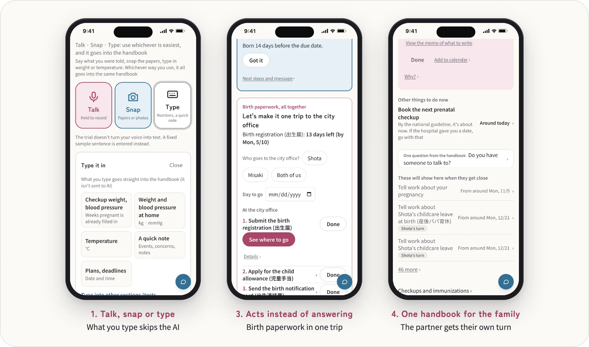
</p>

1. **Zero input, never forced**: talk or take a photo (a letter from the city, a checkup slip); it becomes dated records and deadlines. When typing is faster (weight, blood pressure, temperature, a date, a time, a short note), a "Type" button of the same size lets you enter it on the spot — it goes straight into the techo without AI. Values read from photos or speech can be corrected before you tap OK. It asks at most one question.
2. **Lives through 1,000 days**: a family clock (weeks of pregnancy, days since birth) surfaces what to do today. Local rules for your own city are researched with Claude's web search, with sources.
3. **Acts instead of answering**: drafts of the message to your employer, birth-registration notes, daycare visit requests. The family only says "OK". Nothing is sent.
4. **One handbook for the family**: the partner opens the same handbook (through an invite link) and sees their own tasks and drafts written in their own name. Tasks go to whoever the law and the system name (for work matters, the parent who is employed).
5. **A bridge to medicine, not a wall**: the day of a prenatal checkup. The day before, it shows "Checkup tomorrow at 10:30" with what to bring and what to ask, and suggests asking the doctor, "May I record this?" at the start of the exam. It records in the app, transcribes on a home GPU, and turns it into what the doctor said, what to do next, the next appointment, plain-language notes for jargon (always next to the doctor's own words) and questions for next time. Photograph a big hospital's floor map and get today's route. **It never judges health.**
6. **Fetches your city's rules**: for any city, the office, what to bring and the deadline for each procedure are fetched from the official pages.
7. **A gift to the child**: the 1,000 days of records become a book that speaks to the child.

### Carrying the soul of the paper handbook

The national handbook format has been refined for 78 years. We keep its seven qualities: the family holds it, it continues from pregnancy onward, parent and doctor records sit side by side, vaccination records serve as proof, it asks every time whether you have someone to talk to, it keeps the family's own words, and it leaves no one behind.

<p align="center">
  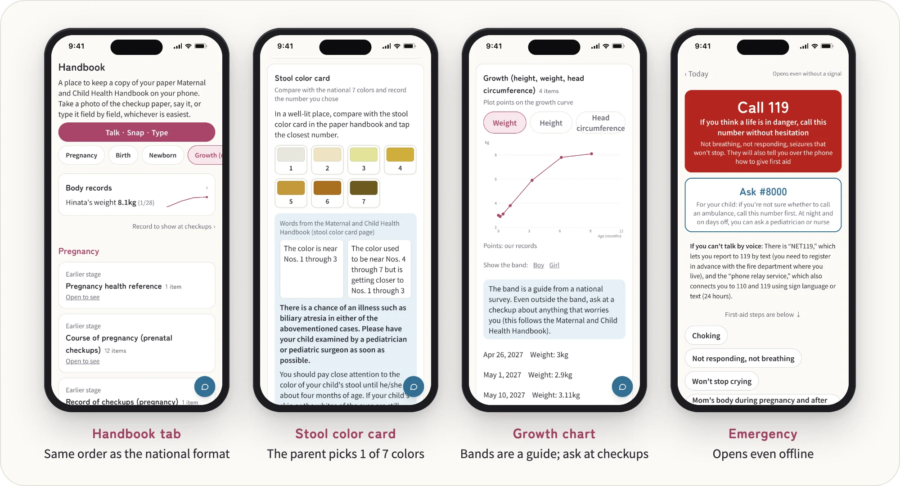
</p>

- **Handbook tab**: records in the same order as the national format (prenatal checkups, birth, newborn, stool color card, growth and milestones, vaccinations, consultations, and finally the book). Growth charts use the Children and Families Agency's 2023 National Growth Survey on Preschool Children (published 2024-12-25; values between age bands are joined by straight lines, an approximation); for the stool color card the parent picks one of the seven official colors (the app never judges; the notes are the handbook's own wording).
- **Record by photo or voice**: photograph a page of the paper handbook and Claude identifies the page and proposes entries; saying "rolled over today" or "got the BCG shot" works too. Nothing is saved until the family taps OK. The paper handbook stays the original.
- **Someone to talk to**: once per stage, the app asks the handbook's recurring question (kept word for word in Japanese), "Is there someone you can casually talk to about raising your child?" If not, it links to the city's child and family center, postpartum care, the #8000 pediatric line and the child guidance hotline.
- **Emergency page**: call 119 without hesitation if a life may be in danger; if unsure whether to call an ambulance, #8000 (children) and #7119 (the mother's body, where the town offers it), and short steps for choking and CPR (based on the Children and Families Agency's handbook pages and the Japan Resuscitation Council guidelines). It opens even offline.

The author is user #1, using it at a family member's real prenatal checkups (real records are never published). At one real checkup during the hackathon, the summary made from the recording misheard an important date. So a heard date now stays out of the calendar, messages to family and the shared page until the person taps OK; inside the handbook it shows as "Date heard from the recording · not checked yet" (see section 7 of [Built with Claude Code](docs/BUILT_WITH_CLAUDE_CODE.md)).

## How Claude is used

Each job uses the model that fits it: everyday jobs run on Sonnet, deep reading runs on Opus, and the guard and formatting run on Haiku.

<p align="center">
  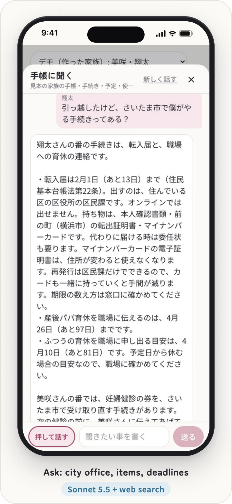
  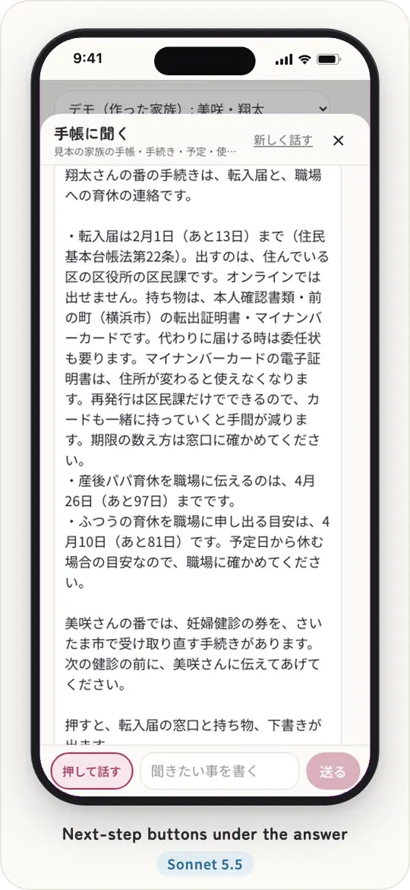
  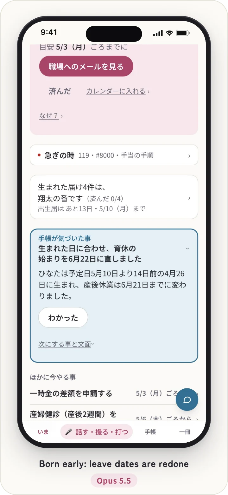
  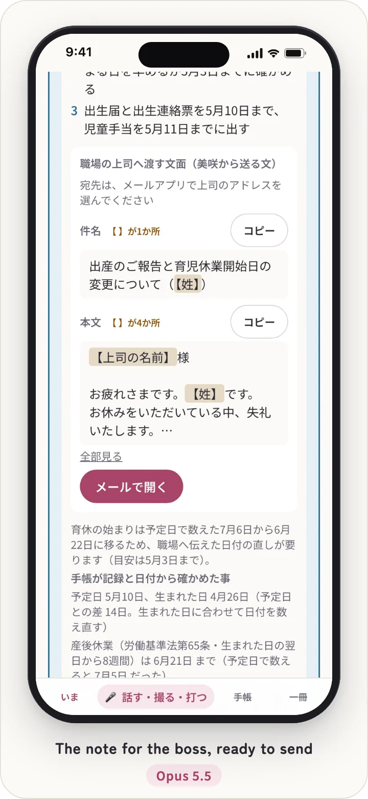
  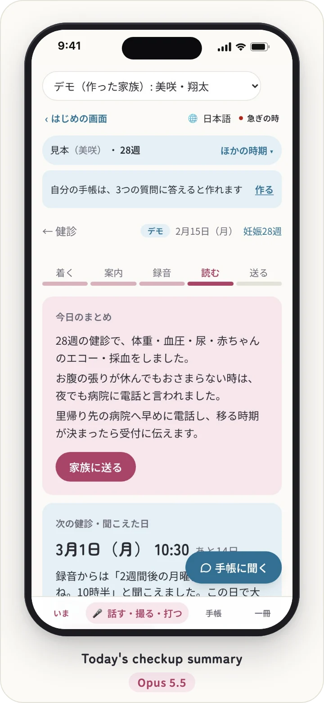
  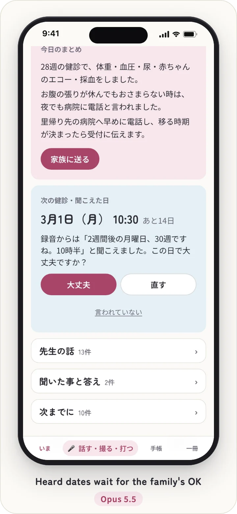
</p>

<p align="center"><sub>From the 3-minute demo recording (a made-up family; the screens are in Japanese). Every answer is a real Claude response; which model wrote each one was checked against the recording's usage log</sub></p>

| Job | Model | Why |
|---|---|---|
| Capture: turn voice and photos into proposed entries; identify a page of the paper handbook | Sonnet 5.5 (`EVERYDAY_MODEL`) | Everyday job; half Opus's price |
| Drafts (the email to the employer, birth-registration notes, ...) | Sonnet 5.5 (`EVERYDAY_MODEL`) | Everyday job |
| "Ask the handbook" agent (picks its own tools, up to 8 steps) and rewrites when the guard flags a reply | Sonnet 5.5 (`EVERYDAY_MODEL`) | Everyday job |
| Research with web search (city offices, what to bring, deadlines; also the agent's official-page search and the old-vs-new city comparison after a move) | Sonnet 5.5 (`RESEARCH_MODEL`) | Each call reads about 80k tokens of search results; the text is reshaped afterwards and the source URLs are kept, so Sonnet holds the quality |
| Advisor: replanning when the baby comes early or late or the family moves, and a once-per-stage look across the family's records | Opus 5.5 (`MODEL`) | Deep work: cross-checks the family's situation, schedule and records to find what no fixed rule covers |
| Checkup notes (what the doctor said, what to do next, questions for next time) and a route from a hospital floor map | Opus 5.5 (`MODEL`) | Deep work: keeps the words as heard intact |
| The book for the child (1,000 days of records and the family's words) | Opus 5.5 (`MODEL`) | Deep work: one long piece of writing |
| Guard on every "Ask" reply (looks for medical, mental-health and nutrition judgments) | Haiku 5.5 (`LIGHT_MODEL`) | Light job, once per reply |
| Reshaping research into office / what to bring / deadline fields | Haiku 5.5 (`LIGHT_MODEL`) | Light job, formatting only |

The source of truth is the four constants in [`app/src/lib/claude.ts`](app/src/lib/claude.ts) (`MODEL`, `EVERYDAY_MODEL`, `LIGHT_MODEL`, `RESEARCH_MODEL`). Only the Opus jobs add server-side fallbacks for refusals.

- Structured outputs with zod, image input for photos, and the web search tool with citations (the pages cited in the answer are kept as sources).
- "Ask the handbook" (the floating button on every screen) looks up the family's schedule, records, official town pages and an in-app screen map, then answers and attaches actions (open the right screen, draft, mark done, add a checkup question, record, a ready-to-send message). Nothing is written until the family taps. Body, mental-health and nutrition questions get no judgment, only a bridge: a dated record, a question for the doctor, and phone numbers; urgent words always add 119/#8000 by rule, and the Haiku guard has any judgment rewritten.
- A shared charter (`CHARTER`) forbids medical judgment in every call.
- Spend caps: every call is metered (`lib/spend.ts`); past `BOSHI_DAILY_USD` (whole server per day) or `BOSHI_HOUSEHOLD_DAILY_USD` (one household per day), only the Claude jobs stop. The schedule, deadlines and emergency page keep working.
- Without an API key, or once a cap is reached, the demo family answers with clearly labeled sample answers ([`lib/samples.ts`](app/src/lib/samples.ts)); city research, checkup notes and the hospital floor-map route have no samples and need a key (no GPU needed).
- The public trial does not call Claude during the hackathon, and it limits trial copies per IP address per day (`BOSHI_TRIALS_PER_IP_DAY`, default 10, 100 in the public config) and photos and voice per copy (20 items, 50 MB).
- The whole project was built with Claude Code, with parallel agents per feature; the commit history is the record.

## Tests

- **1,534 tests in 116 files** (as of 2026-11-07, `npm test`). No Claude calls and no keys. GitHub Actions (`.github/workflows/check.yml`) runs types, lint, tests, the fast-forward and `next build` on every push to main and every PR.
- **Fast-forward: 23 rules (a–w) × 1,030 families × 1,000 days** (`npm run sim`). 1,000 synthetic families drawn from public statistics (1,035,345 family-days; the families move every day, and the screen is checked weekly and on milestone days) and 30 hand-made rare cases (28,767 family-days, checked every day) pass through the same functions as the Today screen. The 9 handbook-record rules (t1–t9) are checked on 1,031 families (adding the demo family). All pass today.
- **Cross-household tests**: with family A's login, every record, done item, handbook entry and photo id of family B returns 404 (`app/src/sim/cross-household.test.ts`). A source-reading test checks that every API route (including the checkup routes) goes through the household gate (`withHousehold`) or is a public route with a stated reason (`app/src/sim/api-guard.test.ts`).

Every change is fast-forwarded through 1,000 days with 1,000 synthetic families drawn from Japanese public statistics (sources: [docs/SIM_STATS.md](docs/SIM_STATS.md), in Japanese). Results: [docs/SIMULATION_RESULTS.md](docs/SIMULATION_RESULTS.md). How it was built with Claude Code: [docs/BUILT_WITH_CLAUDE_CODE.md](docs/BUILT_WITH_CLAUDE_CODE.md). Architecture, run modes and where it would live at national scale: [docs/ARCHITECTURE.md](docs/ARCHITECTURE.md) (in Japanese). After the hackathon it would move to a major cloud (Google Cloud or AWS) together with a rewrite to a managed database, object storage and KMS; of the docs we checked on 2026-11-05, only Amazon Bedrock (Tokyo and Osaka) confirms in-Japan processing for Claude, and it has no web search tool, so city research would need rework there.

## Run

See the Japanese section above (`cd app && npm install && cp .env.example .env.local && npm run dev`). `.env.example` starts with `BOSHI_DATA_DIR=./try-data`; without it the app treats `app/data/` as a real family's store and keeps accounts, memories, letters and films closed. Without `ANTHROPIC_API_KEY`, the schedule, deadlines and emergency contacts still work, and the demo family shows clearly labeled sample answers for the Claude features (photos are not read; city research, checkup notes and the floor-map route need a key). Without `ASR_URL`, the demo families use a bundled demo transcript, so the visit flow works without a GPU (organizing the notes still needs a key); a real household's voice notes get an error instead of demo text, and the home server refuses to start without `ASR_URL`. There are four run modes (home production, public trial, simulation, local dev; `app/src/lib/mode.ts`), and unsafe combinations, such as the public trial or the simulation opening the real family's store, stop the server at startup. The home production server is rebuilt from a clean checkout of main, checked on port 3211, then swapped in, with rollback (`app/scripts/release-prod.sh`).

## Public trial

`BOSHI_PUBLIC=1` runs a version anyone can try (live now at https://boshi-techo-try.fly.dev/, no login needed): each visitor gets a private copy of the demo family (bound to a cookie, deleted after 7 days). Sign-up, invites and export are closed. **During the hackathon the public trial does not call Claude**: no API key is set, and the public build refuses to call Claude even if one is. Claude's part is shown with a book Claude wrote earlier and with clearly labeled sample answers; spoken notes are not transcribed (a fixed sample sentence is used). To host it yourself on Fly.io (Tokyo), see `app/Dockerfile` and `app/fly.toml` (`fly launch --no-deploy --copy-config`, create a 3 GB `boshi_data` volume, pass only `BETTER_AUTH_SECRET` and `BOSHI_KEK` through stdin with `fly secrets import`, then `fly deploy --remote-only` from a clean checkout of main).

Sample media were all made during the hackathon and show no real people: photos generated with Z-Image-Turbo (Apache-2.0); voices synthesized with the AivisSpeech models 「まお」, 「阿井田 茂」 and 「ろてじん（長老ボイス）」 (ACML 1.0) and with Qwen3-TTS 1.7B VoiceDesign (Apache-2.0); the film music is a music box played in the browser. Fonts: Zen Maru Gothic and Noto Sans JP (screens) and fonts-noto-cjk (the public trial image), all under the SIL Open Font License 1.1.

## License

MIT
