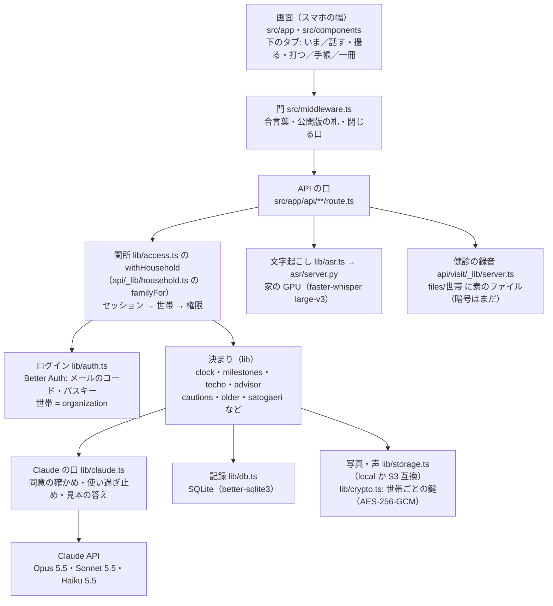

# しくみ

母子手帳のアプリ（`app/`・Next.js 15）と、健診の録音を文字にする小さなサーバ（`asr/`）でできています。記録は SQLite に置き、写真と声のファイルは世帯ごとの鍵で暗号にしてから置きます（健診の録音と記録の文字は、まだ暗号にしていません）。Claude は仕事ごとにモデルを分けて呼びます。

## 層



- 関所は「セッション → 世帯 → 権限」の順に確かめ、その世帯の中だけに触れる道具（`ctx.db`・置き場）を渡します。ほかの世帯は 404、ログインが無ければ 401、権限が無ければ 403 です。
- 役は4つです（`lib/access.ts` の `ROLE_PERMS`）: 持ち主（owner）・共同の管理（admin。パートナーなど）・読むだけ（member。祖父母など）・ゲスト（guest。作った家族をログインなしで開く時）。
- アカウントで開いた本物の世帯の記録を Claude に送る前に、送る本人の全員に「米国の Claude に送る同意」があるかを確かめ、送った事を操作の記録に残します（`lib/claude.ts` の `guardSend`）。作った家族は、守る本人がいないので同意を見ません。アカウントの前の通し方（下の「わが家の本番」）では、この確かめは効きません。
- 読むだけの人への絞り込みは、写真と声（本人ごと）と手帳と健診に効きます。手帳は子の頁だけを渡します（`lib/mother-records.ts`。`/api/techo` と書き出しが、ママの頁・妊娠中のワクチン・お産のしかた・まだ OK していない候補を外す）。健診の口は開けません（403。子の健診も一緒に隠れます）。ほかの文字の記録（話した記録・一冊・手帳に聞く・下書きなど）には本人（`subject_id`）がまだ付かないので、世帯の分が見えます。母の記録の見せる範囲を選ぶ仕組みは準備中で、同意の画面と招待の画面にもそう書いています。
- 健診の口（`api/visit`）は、健診を id で引いてから、その健診の世帯で関所を通します（`api/visit/_lib/server.ts` の `visitFor`）。よその世帯の健診は、在るかどうかも見せずに 404 です。録音の一切れは1回 32MB まで（取り込むボイスメモも同じ口）、世帯を消すと録音の置き場（`files/<世帯>`）も消します。

## 動かし方

動かし方は4つです（`app/src/lib/mode.ts`）。

| 動かし方 | 何のため | 立て方 | 置き場 | 決める環境変数 | 世帯と関所 | Claude |
|---|---|---|---|---|---|---|
| home: わが家の本番 | 作り手の家族が毎日使う | `app/scripts/serve-prod.sh`（127.0.0.1:3210・組み立て済み・Tailscale Serve の https）。更新は `app/scripts/release-prod.sh` | 家族の本物の記録（git の外。絶対パスで指す） | `BOSHI_MODE=home` と `BOSHI_DATA_DIR`（serve-prod.sh が入れる）・`ASR_URL`（無いと立たない） | 127.0.0.1 で待ち、Tailscale Serve の https だけで開く。今は前の通し方（家族の id で引く。`api/_lib/household.ts` の `legacyAccess`）。アカウントの関所は `BOSHI_ACCOUNTS=1` を入れた時から（写しで試してから移る） | 本番の鍵（月の上限つきのワークスペース）と、1日の上限 |
| public: 公開版（体験） | だれでも触れる | `app/Dockerfile`・`app/fly.toml`（Fly.io 東京の1台） | Fly の箱 `/data` | `BOSHI_PUBLIC=1`（組み立ては `NEXT_PUBLIC_BOSHI_PUBLIC=1`）・`BOSHI_DATA_DIR=/data`。秘密は `BETTER_AUTH_SECRET` と `BOSHI_KEK` だけ | 開いた人ごとに見本の家族の写し（札＝クッキーの持ち主だけ・7日で消える）。登録・招待・書き出し・シミュレーションの口は閉じる。健診は読むだけ | 呼ばない（見本の答え） |
| sim: シミュレーション | 作った家族のなりきり | `app/scripts/sim-server.sh`（3100番・組み立ては `.next-sim`） | `app/sim-data`（git の外） | `BOSHI_SIM=1`・`BOSHI_SIM_LOGIN=1`（既定）・`BOSHI_SIM_BUDGET_USD`（既定 21）・`BOSHI_SIM_HOUSEHOLD_USD`（既定 3） | 30家族と1000組を、仮のアカウント `sim:<家族id>`（その世帯の owner）で開く（`/api/sim/login`。`BOSHI_SIM=1` の時だけ。ほかは 404） | 検査の鍵を、その時だけ環境変数で渡す |
| dev: 手元の試し | 作る・直す・手元で試す | `npm run dev`（3000番） | `./try-data`（`.env.example` の頭の `BOSHI_DATA_DIR`） | `.env.example` を写した `.env.local` | アカウントの関所が動く。見本の家族はログインなしで開ける | 鍵があれば呼ぶ。無ければ見本の家族は見本の答え |

- 危ない組み合わせは、サーバが立つ時に止めます（`src/instrumentation-node.ts` の `checkMode`。決まりは `lib/mode.ts` の `modeProblems`）: 公開版やシミュレーションが、わが家の置き場を開く／`BOSHI_MODE` が `home` 以外／`BOSHI_MODE=home` なのに置き場が絶対パスでない・`boshi.db` が無い／わが家の本番に `ASR_URL` が無い。どれも、間違えると本物の家族の記録が別の人に見える・空の記録で上書きされる・本物の健診にデモの会話が入る組み合わせです。
- 「わが家の置き場」は、`BOSHI_MODE=home` の時か、`BOSHI_DATA_DIR` を指定しない時（`app/data` を開く）です。
- 文字起こしの機械が無い時は、用意したデモの文字起こしに落とします。本物の世帯の「話す」の記録（`api/capture/voice`）は、デモの文を入れずに 503 で止めます（`lib/asr.ts` の `transcribe` に家族を渡す口）。聞くの声はデモの文を問いにせず 503 で止め、思い出の声はデモの文を残しません（どちらも `t.demo` を見る）。健診の録音も、本物の世帯ではデモの文字起こしを入れずに止めます（整理は「文字起こしができませんでした」で止まり、録音は残るので、機械がつながってから「もう一度やってみる」で続けられます）。わが家の本番は `ASR_URL` が無いと立たないので、わが家の本番でデモの文が入る事はありません。
- 本番の更新（`release-prod.sh`）は、わが家の記録の控えを取り、GitHub の main のきれいな写しを別の置き場で組み立て、3211番で確かめてから差し替えます。録音中・文字起こし中・整理中の健診があれば止め、差し替えた後に確かめてだめなら前の版に戻します（`--dry-run`・`--rollback`）。
- 試験（`npm test`・CI）は、一時の置き場で動き、わが家の置き場に触れません（`app/vitest.setup.ts` と `lib/db.ts` の `assertNotHomeInTests` の二重の止め）。鍵も使いません。

### アカウントと置き場の環境変数

| 環境変数 | 中身 |
|---|---|
| `BETTER_AUTH_SECRET` | ログイン（Better Auth）の鍵。本番（`NODE_ENV=production`）では無いと立たない（`lib/secrets.ts`） |
| `BOSHI_KEK` | 世帯ごとの鍵（DEK）を包む親鍵。本番では無いと立たない（`lib/crypto.ts`） |
| `BETTER_AUTH_URL`・`BOSHI_PASSKEY_RP_ID` | ログインの戻り先の住所と、パスキーを結ぶ住所（空なら届いた住所で組む） |
| `BOSHI_ACCOUNTS` | わが家の置き場でアカウントの表を作ってよい時だけ `1`（ほかの置き場では、いつも動く） |
| `BOSHI_PASSCODE`・`BOSHI_LOGIN_GATE` | 合言葉の門。`BOSHI_LOGIN_GATE=1` でログインの札を持つ人も通す（`lib/gate.ts`） |
| `BOSHI_STORAGE`・`BOSHI_S3_*` | 写真と声の置き場。`local`（既定）か `s3`（S3 互換。`lib/storage.ts`） |
| `BOSHI_DAILY_USD`・`BOSHI_HOUSEHOLD_DAILY_USD` | Claude の使い過ぎ止め（サーバ全体の1日・1つの世帯の1日。`lib/spend.ts`） |
| `BOSHI_TRIALS_PER_IP_DAY` | 公開版で、1つの住所から1日に作れる体験の写し（既定 10。`fly.toml` は 100） |

## Claude のモデル

| 仕事 | モデル（定数） | 理由 | コード |
|---|---|---|---|
| 撮る・話す（声と写真の読み取り → 記録の候補。紙の手帳のページを見分ける） | Sonnet 5.5（`EVERYDAY_MODEL`） | 毎日の仕事。単価は Opus の半分 | `lib/capture.ts` |
| 下書き | Sonnet 5.5（`EVERYDAY_MODEL`） | 毎日の仕事 | `lib/drafts.ts` |
| 手帳に聞く（道具を選ぶ・最大8手）と、見張りに言われた時の書き直し | Sonnet 5.5（`EVERYDAY_MODEL`） | 毎日の仕事 | `lib/ask/agent.ts` |
| 調べ物（町の窓口・持ち物・期限、手帳に聞くの公式ページの検索、引っ越しの時の前の町との差） | Sonnet 5.5（`RESEARCH_MODEL`） | 1回に検索の結果を約8万トークン読む。書き出した文は後で整え、出典も残すので Sonnet で質を保てる | `lib/local.ts`・`lib/ask/tools.ts`・`api/advisor/_lib/write.ts` |
| 参謀の気づき（早く・遅く生まれた・町が変わった）と、時期ごとの見渡し | Opus 5.5（`MODEL`） | 深い仕事。家族の形・予定・記録を突き合わせる | `api/advisor/_lib/write.ts` |
| 健診の整理と、院内の案内図から回る順番 | Opus 5.5（`MODEL`） | 深い仕事。先生の言葉を崩さずに分ける | `api/visit/_lib/server.ts` |
| 一冊 | Opus 5.5（`MODEL`） | 深い仕事。一度きりの長い文 | `lib/book.ts` |
| 手帳に聞くの見張り | Haiku 5.5（`LIGHT_MODEL`） | 返事のたびに1回の軽い仕事 | `lib/ask/agent.ts` |
| 調べ物の整え | Haiku 5.5（`LIGHT_MODEL`） | 形を整えるだけ | `lib/local.ts` |

- 正本は `app/src/lib/claude.ts` の4つの定数（`MODEL`・`EVERYDAY_MODEL`・`LIGHT_MODEL`・`RESEARCH_MODEL`）。`structured()` の既定は `MODEL`、`research()` の既定は `RESEARCH_MODEL` です。
- Opus の仕事だけ、断られた時の呼び直し（server-side fallbacks）を付けます。
- 呼ぶたびに使った額を `spend.jsonl` に書き（`lib/spend.ts`）、1日の上限（全体・世帯）を超えたら Claude の仕事だけを止めます。見本の家族は、鍵が無い時と上限に達した日に `lib/samples.ts` の見本の答えで動きます。

## ファイル

```
app/                       Next.js 15（App Router・TypeScript・Tailwind 4）
  src/middleware.ts        門（合言葉・公開版の札・公開版で閉じる口）
  src/instrumentation*.ts  サーバが立つ時の確かめ（動かし方）と、体験の写しの掃除
  src/lib/mode.ts          動かし方（home・public・sim・dev）と、立ててはいけない組み合わせ
  src/lib/clock.ts         家族の時計（妊娠週数・生後日数・1000日の何日目か）
  src/lib/milestones.ts    全国共通の「その時やる事」（法律・国の目安だけ。根拠つき）
  src/lib/demo-family.ts   デモの家族（すべて架空。町だけ実在のさいたま市）
  src/lib/family.ts        家族を引く（デモ＝固定／わが家＝DB の profile）
  src/lib/access.ts        関所（withHousehold）と役ごとの権限
  src/lib/households.ts    世帯・本人・代理・同意・操作の記録
  src/lib/auth.ts          ログイン（Better Auth）
  src/lib/claude.ts        Claude を呼ぶ共通の部品（structured＝決まった形で受け取る／research＝web 検索つき／imageBlock）
  src/lib/spend.ts         使った額の記録と上限
  src/lib/samples.ts       鍵が無い時の見本の答え
  src/lib/trial.ts         公開版の体験の写し
  src/lib/asr.ts           録音を文字にする（自宅の GPU の機械の asr/server.py）
  src/lib/db.ts            SQLite の docs 表（type ごとに JSON を置く）。置き場は git の外
  src/lib/storage.ts       写真・声の置き場（local・S3 互換）
  src/lib/crypto.ts        世帯ごとの鍵（DEK）と親鍵（KEK）で暗号にする
  src/lib/api.ts           API ルートの包み route() と body()
  src/lib/techo.ts         母子手帳の記録の背骨（府令様式のページの並び・記録の形・便色の7色・手帳と同じ注意書き）
  src/lib/techo-seed.ts    作った家族（デモ・sim-・pop-）の手帳の記録を統計から作る（わが家には作らない。出典はファイルの頭）
  src/app/techo            手帳のタブ（府令の並びで記録を見る・発育曲線・便色カード・予防接種の控え・最後に一冊）
  src/app/emergency        急ぎの時（命が危ない時は119・迷う時は #8000／#7119・窒息と心肺蘇生）。家族の読み込みを待たずに出し、public/sw.js が通信なしでも開けるよう取っておく
  src/components/today/ConsultAsk.tsx  時期ごとに1回「相談できる人はいますか」を聞き、「いない」なら町の相談先へ橋をかける
  src/lib/app-guide.ts     画面の地図（どの画面で何ができるか。手帳に聞くが使い方を答える正本。下のタブの並びもここ）
  src/lib/ask/             手帳に聞く: agent.ts（道具を使うループ・会話の決まり・見張り）・tools.ts（予定・手帳・町・動きの道具）・bridge.ts（急ぎ・心の危機の床）
  src/components/ask/AskSheet.tsx  右下の「聞く」と窓（返事の下の動き: 画面へ行く・窓口と下書き・済みにする・健診で聞く・記録する・渡す文・電話）
  src/components/FamilyProvider.tsx  見ている家族と「今日」を全画面で共有（useFamily）、api() 呼び出し
  src/components/Shell.tsx           上の家族切り替え・下のタブ（いま／話す・撮る・打つ／手帳／一冊。並びは lib/app-guide.ts の TABS）
  src/sim/                 作った家族（30家族・1000組）と早送りの検査・世帯をまたぐ試験
asr/server.py              文字起こしサーバ（faster-whisper large-v3）
```

## 約束

- 体の判断をしない（`CHARTER` in claude.ts）。言い換えは元の言葉を必ず並べる。
- 本物の家族の記録・録音は git の外の置き場にだけ置く（公開リポジトリに入らない）。
- Claude のモデルは仕事ごとに分ける（上の表。正本は `lib/claude.ts`）。決まった形は zod で受け取る。
- 手帳の体の数字は、家族が話したか紙の手帳から写した物だけ。撮った・話した記録は候補（pending）で入り、家族の OK で確定する。数字・色・発達に「異常」「正常」を言わず、手帳と同じ注意書きと相談先への橋だけを出す。
- 画面はスマホの幅（max-w-md）で作る。色は globals.css のトークン（paper・card・ink・muted・line・rose・sky・ok・warn・alert）。見出しは `font-display`。

## 記録の種類（db の type）

`lib/db.ts` の `DocType` は13種類です。

| type | 中身 |
|---|---|
| record | 話した・撮った記録（①入力ゼロ） |
| ask | 撮る・話すの聞き返し（画面を開き直しても答えられるように残す。①） |
| techo | 母子手帳の記録 1 件（`TechoEntry`。page＝府令のページ・date・values・source＝voice/photo/text/seed・pending＝OK 前の候補） |
| visit | 健診 1 回分（⑤）: 録音・文字起こし・整理・院内の道案内。次の健診の予約と聞く事も、この type の中に置く（kind: plan） |
| local | 町の制度の調べ結果（②⑥）。町×手続きで1回だけ調べ、ほかの家族と使い回す |
| draft | 下書き（③） |
| done | 済んだ事 |
| advice | 参謀の気づき（④。きっかけの鍵ごと） |
| chat | 手帳に聞くの会話（家族ごとに1つ。問いと答えを1件ずつ数えて、直近80件。Claude に渡すのは直近20件） |
| book | 一冊（⑦） |
| letter | 未来の手紙（開く日まで封をする。中身は世帯の鍵で暗号にして置く。Claude には送らない） |
| profile | わが家の設定（町・予定日・家族の形） |
| plan | 型と書き出しの対象にはあるが、今は書く所が無い |

docs の外に、世帯（households）・本人（subjects）・同意（consents）・代理（proxies）・操作の記録（audit）・世帯の鍵（household_keys）・写真と声の台帳（media）・体験の写し（trials）の表と、Better Auth の表があります。

## 母子手帳の記録（techo）の流れ

```
話す・撮る ──> Claude がページを見分けて行を取り出す ──> 候補（pending:true）
                                                   └─ 家族の「OK」 ──> 記録（pending なし）──> 手帳のタブ・一冊
打つ（体重・血圧・体温・日付・ひとこと） ──> AI を通さずそのまま記録
今日の画面の「相談できる人はいますか」 ──> page "consult" に記録
作った家族 ──> seedTecho(family, today) ──> 統計から作った記録（source "seed"。わが家には無い）
```

- 並びは府令様式（母子保健法施行規則 様式第三号、2026年4月施行版）と同じ。紙の手帳が正本のまま、二重に書かせない。
- 作った家族の記録の決まり（今日より後の日付が無い・体の数字が家族のデータか出典の範囲・判定の言葉が無い・わが家には無い）は、早送りの検査（`npm run sim`）が毎回確かめる。

## 手帳に聞く（どの画面からも）

```
家族の問い（書く・押して話す）──> 機械の床（bridge.ts: 急ぎ・心の危機の言葉に電話と「急ぎの時」）
   └─> Sonnet 5.5 が道具を選ぶ（最大8手）
         読む: get_plan（予定）・get_notebook（手帳・記録・健診）・look_up_town（町の公式ページ）・search_official（予定に無い制度）
         動く: open_screen・offer_paperwork・propose_done・add_checkup_question・add_record・write_message（ボタンを積むだけ。書き込まない）
   └─> 見張り（Haiku 5.5: 体・心・栄養の判断の言葉）──> あれば書き直し（Sonnet 5.5）
   └─> 返事＋動きのボタン ──> 家族が押した時だけ書き込む（記録・健診で聞く事・済んだ印は /api/ask/act が capture・addToAgenda・markDone を呼ぶ。書類の下書きは期限の札から /api/draft）
```

- 答える: 手続き・期限・お金・仕事・町・この家族の予定と記録・アプリの操作（画面の地図だけを根拠に。無い機能は作らない）。
- 判断しない: 体・病気・薬・発達・数値・便の色・心・栄養。記録・健診で聞く事・連絡先への橋に変える（母子手帳そのものの注意書きは、そのまま伝える）。
- 検査: `npx vitest run src/lib/ask src/lib/app-guide.test.ts`（床・道具・地図の抜け）、`NODE_OPTIONS=--conditions=react-server npx tsx scripts/ask-redteam.mts`（体・心・栄養・急ぎの意地悪な問いと対照。結果は `app/sim/out/ask-redteam.md`）。

## 全国へ広げる時の置き場

今の置き場は、試作と体験のための物です。全国の家族が使う時の置き場を、2026-11-05 に調べた事として残します。まだ測っていない数は「見込み」と書きます。

### 今（11/10 まで）

- 公開版（体験）は、Fly.io の東京（`fly.toml` の `primary_region = "nrt"`）の1台と、1つの箱（`/data`）。控えと管理の情報は米国にあります（11/5 の調べ）。
- 体験の写しは7日で消える（`lib/trial.ts`）ので、移す時に運ぶ物はありません。

### 行き先

- 大きな雲（Google Cloud か AWS）へ。11/10 の後、作りの書き直しと一緒に移します。どちらにするかは、その時に決めます。
- 日本に置ける事・ISMAP・3省2ガイドラインとガバメントクラウドの条件は、大手3社でほぼ同じでした（11/5 の調べ）。
- 差が出るのは「Claude を日本の中で処理できるか」です。11/5 に開いた文書で、日本の中の処理を選べると確かめられたのは、AWS の Amazon Bedrock（東京・大阪）だけでした。

| Claude の呼び方 | 日本の中の処理 | 出典 |
|---|---|---|
| Amazon Bedrock（AWS が運営） | 選べる。東京（ap-northeast-1）は日本の推論プロファイル（JP）と東京だけの処理、大阪（ap-northeast-3）は JP。Opus 5.5・Sonnet 5.5・Haiku 5.5 がある。地域を決める呼び方は、全世界の呼び方より1割高い。web 検索のツールと server-side fallbacks は使えないので、調べ物と呼び直しは作り直しが要る | Claude in Amazon Bedrock https://platform.claude.com/docs/en/build-with-claude/claude-in-amazon-bedrock （2026-11-05 確認） |
| Claude API・Claude Platform on AWS（Anthropic が運営） | 処理の場所（`inference_geo`）は global か us。日本は無い | Claude Code の claude-api の手引き（2.1.318。platform-availability・managed-agents-core。2026-11-05 に読んだ版） |
| Claude Models on Google Cloud（Anthropic が運営） | 呼び口の場所（location）は global のまま。処理の場所は global か us で、日本は無い | 同じ手引き（google-cloud-anthropic-managed・platform-availability） |
| Vertex AI（Google が運営） | 地域ごとの呼び口はある（手引き）。日本の地域で最新の Claude を呼べるかは、開いた Google のページに地域の一覧が無く、確かめられなかった | 同じ手引き（google-cloud-anthropic-managed）と https://docs.cloud.google.com/vertex-ai/generative-ai/docs/partner-models/claude （2026-11-05 確認） |

### 作りの直し

- 記録: 今の同期の SQLite（better-sqlite3）を、管理された DB へ。SQLite を直に読み書きする所（`lib/db.ts` の関数・世帯の中の `ctx.db`・SQL の `prepare`）は、アプリの本体（試験・`src/sim`・`lib/db.ts` を除く）で33ファイル・189か所です（2026-11-05 に grep で数えた数）。読み書きが非同期になると、それを呼ぶ関数と API の口も変わるので、直す範囲はこれより広がります（見込み）。
- 写真と声: 物の置き場（Cloud Storage か S3）へ。`lib/storage.ts` の S3 互換の口（`BOSHI_STORAGE=s3`）を、そのまま向けられる見込みです（未実測）。健診の録音は `lib/storage.ts` を通らず、`api/visit/_lib/server.ts` が置き場（`files/<世帯>`）へ素のファイルで直に書くので、移す時に `lib/storage.ts` へ寄せ、写真や声と同じく暗号にします。
- 鍵: 世帯の鍵を包む親鍵（`BOSHI_KEK`）を、雲の鍵の管理（KMS）へ。
- 返事の後に続ける仕事（健診の文字起こしと整理。`api/visit/_lib/server.ts` の `startFinish`）は列（Cloud Tasks など）へ。1日1回の掃除（体験の写し。`src/instrumentation-node.ts`）はスケジューラへ。
- メモリの中の印（`api/ask/route.ts` の `busy`・`api/visit/_lib/server.ts` の `running` など）は、台数が増えると効かないので、DB の印へ。

### 法と指針

- 日本に置く義務はありません。ただし、外国の会社のクラウドを使う時は、その会社がある国とサーバがある国の名前を、本人が知り得る形にします（個人情報保護委員会「『個人情報の保護に関する法律についてのガイドライン』に関するQ&A」Q12-3・Q10-25 https://www.ppc.go.jp/personalinfo/faq/APPI_QA/ 2026-11-05 確認）。
- 使う人向けの母子手帳アプリ（利用者向けアプリ）が守る物は、母子保健法・個人情報保護法とそのガイドライン・漏えい等の対応・民間 PHR 事業者による健診等情報の取扱いに関する基本的指針（PHR 指針）です。3省2ガイドライン（医療情報システムの安全管理に関するガイドライン・医療情報を取り扱う情報システム・サービスの提供事業者における安全管理ガイドライン）は、医療機関等向けアプリの物です（こども家庭庁成育局母子保健課「電子版母子健康手帳ガイドライン」こ成母第349号・2026-03-31 の別添。本文の図表8＝p.21、5.2＝p.22 https://www.cfa.go.jp/assets/contents/node/basic_page/field_ref_resources/909390f5-d0c0-47b9-9b9e-c343b88bde66/dbf17e98/20260331_policies_boshihoken_techou_24.pdf 2026-11-05 確認）。
- 国の母子手帳の記録は PMH に置かれる設計です（同じガイドライン）。この手帳がそこから読む側になる時は、運営者の認証（ISMS・プライバシーマーク）と、PHR 指針に沿っている事の公表が効きます（11/5 の調べ。PHR 指針の本文はここでは開いていません）。
