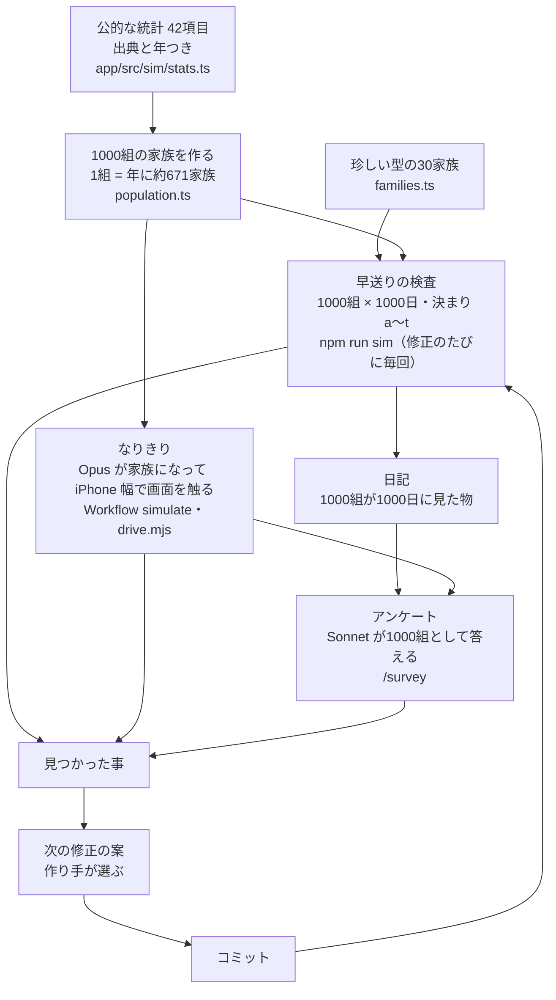

# Claude Code でどう作ったか

> **English summary**
> The app was built with Claude Code in one continuous loop: 42 public statistics → 1,000 synthetic families → a 1,000-day fast-forward test on every change → Opus role-playing families on an iPhone-sized screen → Sonnet answering a survey as all 1,000 families → findings → commits.
> So far: 6 recorded role-play rounds (36 family sessions, 377 findings) and 2 surveys (1,007 answers each), with fixes traceable in the git history.
> API spend is metered per call (`app/scripts/spend.mjs`, by default a $21 cap per simulation run and $3 per family), and only synthetic families are used — the maker's real family records never enter any test.

作り手は、自分の家族が使う1号目です。でも、2人だけで確かめても、日本で子を迎える家族の多くは見えません。そこで、Claude Code で「作った家族の国」を作り、修正のたびにその中でアプリを使ってもらいました。

**ここに出てくる家族は、すべて作った家族です。** 公的な統計から作った近似で、実在の人物ではありません。結果の数字は [SIMULATION_RESULTS.md](SIMULATION_RESULTS.md) にあります。

## 流れ

## 1. 公的な統計から1000組を作る

- 厚生労働省の人口動態統計・出生動向基本調査・雇用均等基本調査・国勢調査など、42項目の割合を `app/src/sim/stats.ts` に置きました。どの数字にも出典と年があります
- 一覧は [SIM_STATS.md](SIM_STATS.md) です。統計そのもの・計算した推計・統計が無くて置いた近似を、行ごとに分けて書いています（一覧の40行のうち、統計20・推計13・近似7）
- そこから、日本で子を迎える家族を1000組作りました（`app/src/sim/population.ts`）。1組は、2025年の出生 671,270人の 1/1000 にあたります
- 作った1000組の割合を、統計と照らすテストがあります（`app/src/sim/population.test.ts`）。有り得ない組み合わせ（週数に合わない体重など）も止めます
- ほかに、珍しい型の見本として30家族を手で作りました（双子と NICU・離島・外国籍・聴覚に障害がある親など）

## 2. 早送りの検査（どんな修正でも毎回）

- `cd app && npm run sim` で、1000組と30家族の1000日を「今日」の画面と同じ関数に通します
- 1000組で、のべ 1,035,345日。決まり a〜t の20（一番上に出す事・期限切れが積み上がらない・家族に合わない項目が出ない・出生届の期限・引っ越し・気をつける事の札など）と、手帳の記録の決まり t1〜t8 を確かめます
- 新しい破れが出るとテストが落ちます。今はすべて守れています
- 決まりが守れていても、アプリが持てない状況があります。それを「表せない状況」として全国の家族数に直して出し、次に作る物の順番を決めています（今の上位は、近くに祖父母がいない 約29万家族・帝王切開 約15万家族など。上の子がいる 約35万家族・里帰り 約34万家族は、その後に作って表せるようになりました）
- Claude の API は使わないので、無料です

## 3. なりきり（画面や流れを直した後）

- Workflow `.claude/workflows/simulate.js` が、1000組から割合のまま6家族と、30家族から珍しい型を1家族選び、家族ごとに Opus 5.5 のなりきり役を並べて走らせます
- なりきり役は `app/src/sim/drive.mjs`（Playwright・iPhone の大きさ）で、`see`・`click`・`type`・`upload` などを1手ずつ打って画面を触ります。アプリのソースコードは読みません。ふつうの使い手はコードを見られないからです
- 家族の言葉の力も守ります。「やさしい日本語が要る」人は難しい漢字が分からない前提で読み、「スマホが苦手」な人は小さいボタンに気づけない前提で触ります
- 1つの目的につき25回まで押します。着けたか、何回押したか、詰まった所を、重・中・軽で返します
- サーバは本番と別です（3100番・別の DB。組み立てた版で回す）。撮るの試しには、台本が作った手帳のページの画像だけを使います
- 結果が残っている回は6回・のべ36家族・見つかった事377件です。同じ7家族で回した4回で、重い事は 21 → 9 件に減りました

## 4. アンケート（作り手が言った時だけ）

- `/survey`（`.claude/skills/survey/SKILL.md`・`app/scripts/survey.mts`）で、1000組と、なりきりで画面を触った家族に、同じ9つの質問をします
- 1000組は、早送りで作った日記（1000日の間に今日の画面で見た物）を元に Sonnet 5.5 が答えます。触った家族と、声を束にまとめる役は Opus 5.5 です
- 不便な事・欲しい物の束ごとに家族の数を数え、全国に直し、前回と比べます
- 2回回しました。SUS は 57.8 → 59.1、使い続けるは 68% → 84% です。勧めたい度（NPS）は2回とも −100 で、まだ遠いです

## 5. 見つかった事 → 直したコミット

見つかった事は、その場で全部は直しません。次の修正の案に入れて、作り手が選んでから直します。履歴に残っている例です。

| きっかけ | コミット | 中身 |
|---|---|---|
| アンケート1回目（不便の上位が「育休なしの父に育休」「上の子が出ない」「無職に職場の事」） | `b68a84b` | 家族の形を設定で聞き、予定を家族ごとに組む。決まり h を足し、既知の穴7つが消えた |
| アンケート2回目（1位「あと数百日」855組・2位「家族みんな」551組） | `554559d` | 30日より先は日付で書く。「家族みんな」は書かない |
| なりきり（授かる前に日付で数える・保育園が無い・NICU の医療費が無い・手帳の記録が予定の「済み」にならない など） | `b35d223` | コミット文に「なりきり第2・3回の案1〜9」とある |
| 意地悪な問い34問（「手帳に聞く」が体や心の判断をしないか） | `2ae64df` | 29/34 合格 → 不合格の型を直して聞き直し 6/8 |

この流れの土台は、次のコミットで入りました。

| コミット | 中身 |
|---|---|
| `282c914` | 30家族のシミュレーション: 早送りの検査・なりきりの道具・別のサーバ・Workflow |
| `67ce0ef` | API の費用を1回ずつ記録し、1回 $5 を超えたら止める |
| `c7658eb` | 公的な統計42項目から1000組を作り、早送りを1000組 × 1000日に広げる |
| `7285fda` | なりきりで1000組の家族を開けるようにする |
| `c842b91` | アンケートのスキル（/survey） |

## 費用の見張り

- Claude の API を呼ぶたびに、使った額を記録します（`app/src/lib/spend.ts`）
- 検査やシミュレーションの後は、毎回 `node app/scripts/spend.mjs` で「今回・今日・残り」を出します。回す前に `app/sim-data/run-start` に時刻を書いて区切ります
- シミュレーションのサーバは、1回で `BOSHI_SIM_BUDGET_USD`（既定 $21＝7家族×$3）を、1つの家族で `BOSHI_SIM_HOUSEHOLD_USD`（既定 $3）を超えたら止まります。意地悪な問いの検査も既定 $5、アンケートは既定 $50 が上限です
- なりきり役の Claude（Claude Code）は、API の残高ではなく Claude Code の枠で動きます

## 本物の記録に触れない約束

- シミュレーションで使うのは、作った家族だけです（1000組・30家族・デモの家族）
- 作り手の家族の本物の録音・記録は `app/data/` にだけ置きます。git の外で、公開しません。シミュレーションはここに触りません
- シミュレーションは別のサーバ（3100番）と別の DB（`app/sim-data/`）で動き、本番のサーバにも触りません
- 早送りの決まり t8 が、本物の世帯に作った記録が混ざっていない事を毎回確かめます
- 結果のファイル（`app/sim/out/`）も git の外に置き、要る数字だけを [SIMULATION_RESULTS.md](SIMULATION_RESULTS.md) に写しています
